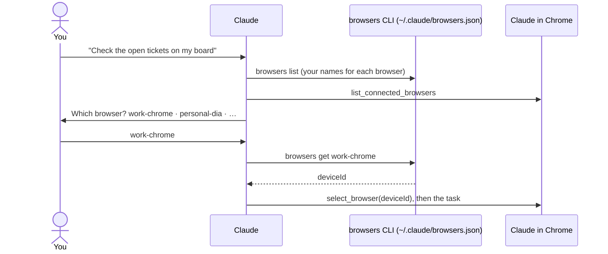

# browser-select

**If you have more than one browser or profile connected to Claude in Chrome, Claude can act in the wrong one: your personal Google account for a work task, or the reverse. This skill makes Claude ask which one, and remember your answer for the session.**



Claude in Chrome identifies each browser by an opaque `deviceId` and a generic name ("Browser 1") that changes between sessions. This skill keeps a small registry of friendly names (`work-chrome`, `personal-dia`) and the `browsers` CLI that reads it. If you say *"use my personal browser"*, Claude resolves it without asking. If you don't name one, it asks.

## Install

```bash
npx skills add stv-io/claude-skills --skill browser-select -g
```

## What you need

- **[Claude in Chrome](https://claude.com/chrome)** installed and signed in, in **more than one** browser or profile. With only one, you don't need this skill.
- **Python 3.**

## Set up: name your browsers (once)

With each browser open and connected, ask Claude: *"register my browsers"*. It lists what's connected, asks you which is which, and saves them. Or by hand:

```bash
~/.claude/skills/browser-select/bin/browsers help-register   # the steps
~/.claude/skills/browser-select/bin/browsers list            # check
```

The names in this README are examples. Use any you like.

## What it looks like

```text
$ browsers list
* work-chrome   3f6c2a1e-8d4b-4e6f-9a2c-1b7d5e0f4a91
                Chrome; work; work Google account, Jira
  personal-dia  9b1e7c44-2f3a-4d8e-b6a0-5c9d2e8f1037
                Dia; personal; personal logins only
  work-dia      c2d8f0a6-7e19-4b3c-8f5d-a4e6b1c9d270
                Dia; work; client tenant

$ browsers get use my personal browser
9b1e7c44-2f3a-4d8e-b6a0-5c9d2e8f1037

$ browsers get my work browser
browsers: 'my work browser' is ambiguous — matches: work-chrome, work-dia
```

An ambiguous name exits 2, and Claude asks you to choose between just those two. `browsers sync` compares the registry with what's connected right now, which is how a browser whose deviceId changed after a re-login gets spotted:

```text
connected:
  work-chrome  (Browser 1, 3f6c2a1e-8d4b-4e6f-9a2c-1b7d5e0f4a91)
registered but not connected right now:
  personal-dia  (last seen 2026-10-30) — open it, or re-auth the extension
  work-dia  (last seen 2026-10-30) — open it, or re-auth the extension
connected but UNKNOWN to the registry:
  Browser 2  77aa0e3b-1c2d-4e5f-8a9b-0c1d2e3f4a5b
  -> a new browser, or an existing one whose deviceId changed after a re-login. Rebind with:
     browsers add <alias> --device-id <uuid>
```

*(Demo names and deviceIds.)*

## What it touches

- **Writes** `~/.claude/browsers.json` (your names, deviceIds and notes).
- **Network:** none. It never opens a page itself.

## Limits

- Re-authenticating the extension can give a browser a new deviceId. Claude spots the mismatch and asks before rebinding the name.
- Two profiles of the same browser look identical from the outside, so registering them always needs your answer.

## Update or remove

```bash
npx skills update browser-select -g
npx skills remove browser-select -g     # then delete ~/.claude/browsers.json if you like
```
