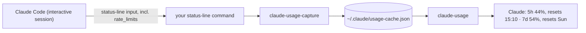

# claude-usage

**Lets Claude check how much of your plan's 5-hour and weekly limits you've used, so it can warn you before starting something expensive (a big fan-out of subagents, a long workflow) instead of hitting the limit halfway through.**



Claude Code gives your plan's rate limits only to the **status-line command**. A one-line hook there saves them to a cache, and the skill reads the cache. Without the hook the skill has nothing to read.

## Install

```bash
npx skills add stv-io/claude-skills --skill claude-usage -g
```

## What you need

- **bash** and **jq 1.6+**. Recent macOS has jq in `/usr/bin`. Otherwise `brew install jq`, or see [jqlang.org/download](https://jqlang.org/download/). Check: `jq --version`.
- **A status-line command** with the hook below.

## Set up: the status-line hook (once)

**If you already have a status line**, add this as its second line (right after it reads its input):

```bash
input=$(cat)
printf '%s' "$input" | ~/.claude/skills/claude-usage/bin/claude-usage-capture
# ...the rest of your status line, using "$input"...
```

**If you don't**, create `~/.claude/statusline.sh`:

```bash
#!/bin/bash
input=$(cat)
printf '%s' "$input" | ~/.claude/skills/claude-usage/bin/claude-usage-capture
printf '%s' "$input" | jq -r '.model.display_name'
```

Then `chmod +x ~/.claude/statusline.sh` and add this to `~/.claude/settings.json`:

```json
{ "statusLine": { "type": "command", "command": "~/.claude/statusline.sh" } }
```

**Check:** in an open Claude Code session, after Claude's next reply, run

```bash
~/.claude/skills/claude-usage/bin/claude-usage
```

It should print `session (5h): …% used` and `weekly (7d): …% used`. More on status lines: [Claude Code docs](https://code.claude.com/docs/en/statusline).

## Use it

*"How much usage do I have left?"*, *"when does my limit reset?"*. Claude also checks before launching anything large, and asks first if the 5-hour window is past 80% or the week past 90%.

## What it touches

- **Writes** `~/.claude/usage-cache.json` (from the hook).
- **Network:** none.

## Limits

- The cache updates only while an interactive session is open. Headless `claude -p` runs don't run the status line. Data older than 5 minutes is reported as stale.
- Limits are account-wide, shared by every session.

## Update or remove

```bash
npx skills update claude-usage -g
npx skills remove claude-usage -g     # and delete the hook line from your status line
```
