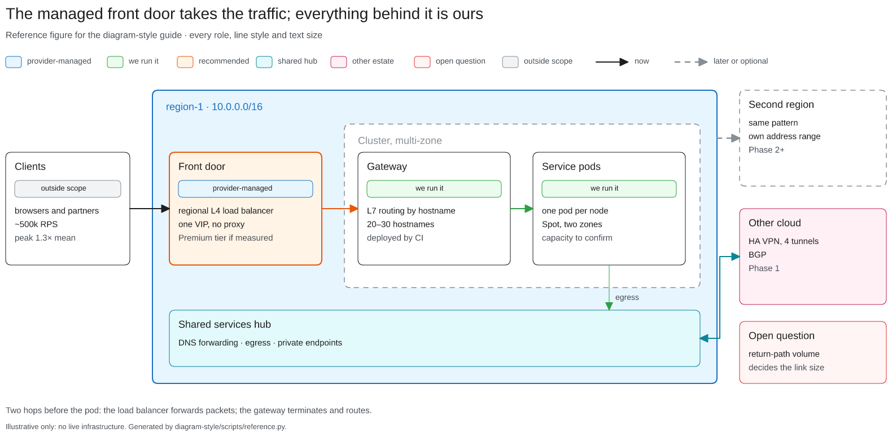

# Diagram style

Read [`STYLE.md`](STYLE.md) before drawing. Take values from
[`tokens.json`](tokens.json) rather than retyping hex codes.

The short version:

1. **Title = the conclusion**, size 28. Subtitle 16 in secondary. Legend of only
   the roles and line styles used. Optional one-line takeaway; a provenance
   line ("Verified <date>: <how>") for anything showing live infrastructure.
2. **Colour by role, not vendor:** `managed` blue, `owned` green, `focus` orange
   (one or two per figure), `hub` cyan, `external` pink, `automation` violet,
   `risk` red, `outside` grey, `later` grey dashed. Three or four roles per figure.
3. **Helvetica (`fontFamily: 2`) everywhere, nothing below 13.** No bold exists
   in Excalidraw; use size and colour.
4. **Flat shapes:** `roughness: 0`, solid fills, rounded corners, stroke 1 for
   cards and 2 for zones and the focus card. Zone titles are separate text at the
   top-left, never a bound label.
5. **Square-cornered arrows**, filled triangle heads, coloured by the source's
   role; solid = now, dashed = later/optional/legacy, dotted = weak.
6. **Official provider icons** via aws-diagrams / gcp-diagrams; every icon has text.
7. **Look at the rendered PNG** before you call it done.

## Reference figure



`scripts/reference.py` draws one figure that uses every role, line style and
text size, straight from `tokens.json`. Use it to check the style renders as
intended, or as a starting point for a new figure.

```bash
python3 scripts/reference.py --out reference.excalidraw          # write the file
python3 scripts/reference.py --post                              # add to the live canvas (does not clear it)
python3 scripts/reference.py --post --dy 1200                    # stack below existing work
```

The canvas URL defaults to `http://127.0.0.1:3030`; override with `--canvas`.
Render a PNG with the Excalidraw MCP `export_to_image` tool.
