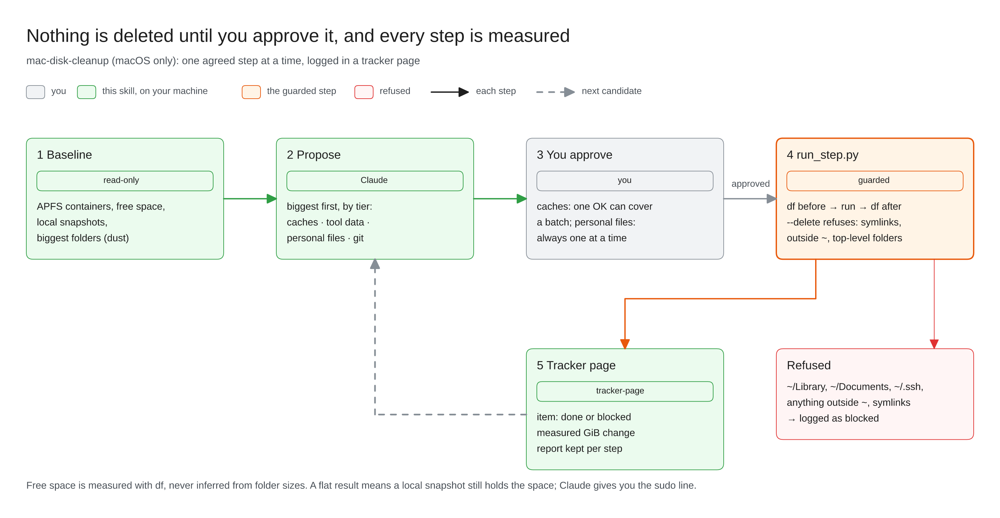

# mac-disk-cleanup

**macOS only. When your Mac's disk is full, Claude finds what's using the space and frees it one step at a time. Nothing is deleted until you approve it, and every step's real effect on free space is measured.**



Disk cleanups go wrong in three ways: deleting something you wanted, killing something that was running, or reporting space that never came back. This skill measures first, agrees each step with you at the right level (one approval can cover a batch of caches; personal files are always one at a time), runs one step at a time, and checks the real change with `df`. It knows the usual developer hotspots and their own clean commands: uv, npm, Homebrew, Nix, Colima/Docker, Terraform providers, duplicate git clones. It also explains why freed space can stay "missing" until a Time Machine local snapshot clears.

## Install

Install it with [tracker-page](../tracker-page), which shows the run as it happens:

```bash
npx skills add stv-io/claude-skills --skill mac-disk-cleanup --skill tracker-page -g
```

## What you need

- **macOS.** It stops on anything else.
- **[dust](https://github.com/bootandy/dust)** for fast folder sizes: `brew install dust`. Check: `dust --version`.
- **Python 3.**

## Use it

*"My disk is full"*, *"free up space"*, *"what's using my disk?"*. If a command fails with "No space left on device", Claude offers this skill. It doesn't start a cleanup on its own.

## What it looks like

Each agreed step goes through `run_step.py`, which measures free space before and after and keeps a report. A demo step deleting a 300 MiB cache:

```text
$ python3 $S/run_step.py ~/disk-cleanup-tracker/runs/2026-10-30 A1 --delete ~/.cache/demo-tool
{"item": "A1", "command": "delete ['~/.cache/demo-tool']", "exit_code": 0,
 "before_free": 260129288192, "after_free": 260442808320, "change": 313520128,
 "report": "~/disk-cleanup-tracker/runs/2026-10-30/reports/20261030-135615-A1.txt"}
```

The tracker item becomes:

```text
done | Exit 0; free space +0.29 GiB, now 242.56 GiB. A flat result usually means a local snapshot still holds the blocks.
```

And a target it won't touch:

```text
$ python3 $S/run_step.py ~/disk-cleanup-tracker/runs/2026-10-30 A2 --delete ~/Library
refusing top-level folder: ~/Library
```

## What it touches

- **Reads** disk usage across your home folder, `/Applications`, `/opt/homebrew` and `/private/var` (sizes only).
- **Writes** a run folder at `~/disk-cleanup-tracker/runs/<date>/` (reports, results, the tracker page).
- **Deletes** only what you approve, step by step. Its `--delete` helper refuses symlinks, anything outside your home folder, and these folders themselves: `~`, `~/Library`, `~/Library/Application Support`, `~/Library/Caches`, `~/Documents`, `~/Desktop`, `~/Downloads`, `~/Pictures`, `~/code`, `~/.cache`, `~/.local`, `~/.local/share`, `~/.config`, `~/.ssh`. Approved clean commands (such as `uv cache clean` or `brew cleanup`) run as they are.
- **Never** uses `sudo` itself. When a step needs it (deleting a local snapshot), Claude gives you the exact command to run.
- **Network:** none from the skill. Some clean commands, such as `brew cleanup`, may contact their own servers.

## Limits

- Free space comes back only after macOS releases it. A local snapshot can hold deleted files for up to a day.
- Measurements taken while other things are writing to disk are noisy. Claude says so.

## Update or remove

```bash
npx skills update mac-disk-cleanup -g
npx skills remove mac-disk-cleanup -g    # run folders under ~/disk-cleanup-tracker stay until you delete them
```
