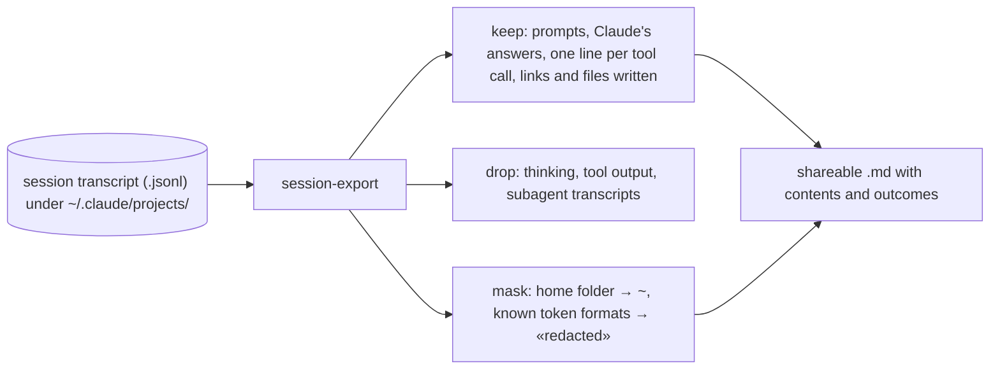

# session-export

**Turns a Claude Code session into a clean Markdown file you can share with your team: what you asked, what Claude answered, and what it did, without the noise.**



`/export` gives you the raw terminal: box-drawing tables, wrapped diffs, every tool result. This gives you numbered prompts, Claude's original Markdown, tool calls collapsed into one line each, a contents list and a list of outcomes. You can export a range of prompts and set a title.

```text
$ session-export --prompts
  1. Read .env.example in this folder and tell me in two sentences what it configures and whether it is…
$ session-export --title "Is this .env safe to commit?" -o ~/env-review.md
session-export: 1 prompts from 9899966f written to ~/env-review.md
session-export: masked 1 secret-assignment — check the «redacted» spots before sharing
```

An excerpt from that export (working directory shortened):

```markdown
## 1. Read .env.example in this folder and tell me in two sentences what it…

> Read .env.example in this folder and tell me in two sentences what it configures and whether it is safe to commit.

<details><summary>1 tool call</summary>

- `Read` — `~/code/demo/.env.example`

</details>

It sets a single variable, `GITHUB_TOKEN`, and the value is not a placeholder … Replace the value
with something like `GITHUB_TOKEN=«redacted»`, and if the token is live, revoke it …
```

The token in the file never appears, because tool output is left out. The masking also caught Claude's suggested placeholder, which is the safe kind of mistake.

## Install

```bash
npx skills add stv-io/claude-skills --skill session-export -g
```

## What you need

- **Python 3.** Nothing else.

## Use it

*"Export this session"*, *"export prompts 3 to 9 for the team"*, *"write up this conversation as Markdown"*. Claude lists the prompts, picks the range with you, writes the file and tells you how many values it masked.

## What it touches

- **Reads** your session transcripts under `~/.claude/projects/` (they contain everything you and Claude wrote in that project).
- **Writes** only the output file you name.
- **Network:** none.

## Limits

- **Masking is best-effort.** It catches the home folder, common token formats (GitHub, Slack, AWS, Atlassian, Anthropic/OpenAI, Grafana, JWTs, private keys) and `*_TOKEN=` / `*_SECRET=` / `*PASSWORD=` / `*API_KEY=` values. Anything else, such as customer names or internal URLs, stays. **Read the file before you share it.**
- It reads Claude Code's transcript format, which is undocumented and changes between releases. If prompts go missing, the format moved; please open an issue.

## Update or remove

```bash
npx skills update session-export -g
npx skills remove session-export -g
```
