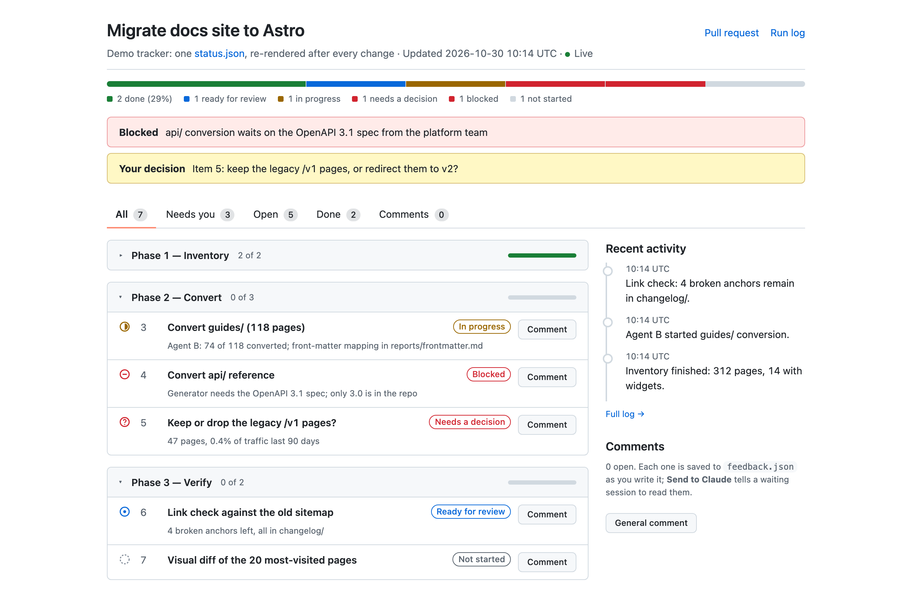

# tracker-page

**A live status page for long agent runs, so you can see where Claude is, what's blocked and what needs you, without scrolling the chat.**

<picture>
  <source media="(prefers-color-scheme: dark)" srcset="../../assets/tracker-page-dark.png">
  
</picture>

*A demo run. Every change Claude makes goes into one `status.json`, and the page re-renders and reloads itself.*

Long tasks (a migration, a review of 200 items, an overnight run) lose their state in the chat. With this skill Claude keeps the state in a file, shows it on `localhost`, and updates it after every step. You can leave comments on any item for later and press **Send to Claude** when you're ready. It also builds side-by-side review pages (before/after, Approve/Hold) for approving content in batches.

## Install

```bash
npx skills add stv-io/claude-skills --skill tracker-page -g
```

## What you need

- **Python 3** (the system one on macOS is enough). Nothing to `pip install`.
- macOS or Linux.
- Optional: [mdserve](https://github.com/jfernandez/mdserve) (`brew install mdserve`) so linked `.md` files open formatted, and [crit](https://crit.md/) (`brew install crit`) for inline comments on the page.

## Use it

Ask for it: *"track this in an HTML page"*, *"give me a status page for this migration"*, *"a review page for these 40 sections"*. Claude creates the folder, starts the server in the background and gives you the URL.

## What it touches

- **Writes** `status.json`, `index.html`, `LOG.md` and `feedback.json` in the folder Claude picks (inside your project), plus a lock file in your temp folder.
- **Serves** that folder on `127.0.0.1` only. It accepts comment posts from its own page only.
- **Network:** none.

## Limits

- The server runs in the foreground of the session that started it, so it stops when that session ends. Claude gives you a one-line restart command.
- Windows isn't supported (it uses POSIX file locks).

## Update or remove

```bash
npx skills update tracker-page -g
npx skills remove tracker-page -g
```

Tests and notes for changing the scripts are in [SKILL.md](SKILL.md#changing-the-scripts).
